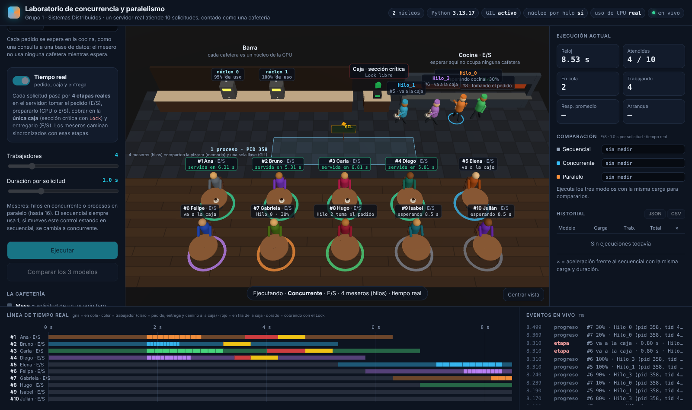
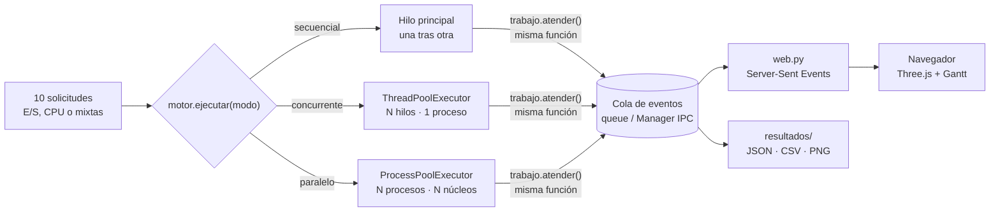

# Laboratorio de concurrencia, paralelismo e hilos

**Grupo 1 · Sistemas Distribuidos** — Un servidor real en Python atiende 10 solicitudes de usuarios de tres formas (**secuencial**, **concurrente** con hilos y **paralela** con procesos). Una visualización 3D en Three.js lo muestra en tiempo real como una **cafetería**: los meseros son hilos, las mesas son solicitudes, las cafeteras son núcleos de la CPU y la cocina es la E/S.

Nada está animado "de mentira": cada movimiento en pantalla corresponde a un evento real emitido por el código que se está ejecutando.



## Inicio rápido

Requisitos: **Python 3.10 o superior** (no se necesita Node ni compilar nada).

```bash
pip install -r requirements.txt     # psutil (uso de CPU) y matplotlib (gráficas)
python -m servidor                  # abre http://127.0.0.1:8000
```

En Windows puede ser `py -m servidor`. Para proyectarlo desde otro equipo de la red: `python -m servidor --host 0.0.0.0`.

Si el puerto 8000 está ocupado o reservado por Windows (`WinError 10013` o `10048`), el servidor prueba solo el 8001, 8002… y muestra en la consola la dirección que quedó activa. También puedes elegirlo: `python -m servidor --puerto 5050`.

En la página: elige el **modelo**, el **tipo de solicitudes** y pulsa **Ejecutar**, o **Comparar los 3 modelos** para correrlos seguidos con la misma carga.

## Qué demuestra

| Escenario | Secuencial | Concurrente (hilos) | Paralelo (procesos) |
| --- | --- | --- | --- |
| **E/S** (esperar una base de datos) | Línea base | Mucho más rápido: mientras un hilo espera, otro avanza | Más rápido, pero paga el costo de crear procesos |
| **CPU** (cálculo pesado) | Línea base | **Casi igual** que secuencial: el GIL de Python turna los hilos | Más rápido, hasta el número de núcleos |
| **Mixto** | Línea base | Aprovecha las esperas | Aprovecha esperas y núcleos |

La conclusión técnica central: **concurrencia no es lo mismo que paralelismo**. Los hilos resuelven bien la espera (E/S); para acelerar cálculo hace falta ejecutar de verdad al mismo tiempo en varios núcleos.

## Arquitectura



- Las tres versiones usan **la misma función de trabajo** y **las mismas solicitudes**; solo cambia cómo se ejecutan. Por eso la comparación es justa.
- Cada solicitud se procesa en 10 pasos y emite eventos `inicio`, `progreso` y `fin` con la hora real, el PID, el identificador del hilo y el núcleo de CPU.
- En modo paralelo los procesos no comparten memoria, así que los eventos viajan por una cola gestionada (comunicación entre procesos, IPC).
- El servidor web usa solo la biblioteca estándar y transmite los eventos con *Server-Sent Events*.

## Estructura

```
servidor/
  trabajo.py       qué hace el servidor con cada solicitud (esperar o calcular) y cómo emite eventos
  solicitudes.py   genera las 10 solicitudes (usuarios, tipo de trabajo, duración)
  motor.py         los tres modelos de ejecución y el cálculo de métricas
  web.py           servidor HTTP + transmisión de eventos en vivo
web/
  escena.js        escena 3D de la cafetería: mesas, meseros, cafeteras, cocina y llave del GIL
  gantt.js         línea de tiempo en vivo
  app.js           controles, métricas, comparación, historial y exportación
medir.py           mediciones definitivas para el documento (repite y promedia)
graficas.py        gráficas PNG para el documento y la presentación
demo_carrera.py    condición de carrera con y sin candado (Lock)
tests/             pruebas automáticas (pytest)
```

## Modo tiempo real (botón «Tiempo real»)

Con el interruptor **Tiempo real** encendido, cada solicitud pasa en el servidor por **cuatro etapas reales**, y los meseros caminan sincronizados con ellas: cada tramo dura exactamente lo que dura la etapa.

| Etapa | En la cafetería | En el sistema | Duración |
| --- | --- | --- | --- |
| 1. Pedido | Ir a la mesa, tomar el pedido y llevarlo a su puesto | E/S: recibir la solicitud por la red | 1,8 s |
| 2. Preparar | Cafetera (CPU) o cocina (E/S) | El trabajo de siempre | la duración elegida |
| 3. Caja | Llevar la cuenta a la **única caja** y cobrar | Recurso compartido con `Lock`: **sección crítica**, uno a la vez | 0,8 s de camino + 0,5 s de cobro |
| 4. Entrega | Llevar la taza a la mesa | E/S: enviar la respuesta | 1,6 s |

- La caja usa `threading.Lock` en secuencial y concurrente, y un `Lock` compartido entre procesos (`Manager().Lock()`) en paralelo. Las pruebas verifican que nunca hay dos cobros a la vez.
- **Lo que demuestra**: por más meseros que haya, los 10 cobros van en fila (al menos 5 s). Esa parte secuencial limita la aceleración: es la **ley de Amdahl**. En la línea de tiempo, rojo = esperando el `Lock` y dorado = cobrando.
- Con el interruptor apagado se mide solo la preparación: es el modelo puro, el adecuado para comparar tiempos entre secuencial, concurrente y paralelo. La comparación y el historial separan ambos modos (marca **TR**).
- Para el documento: `python medir.py --tiempo-real`.

## Cómo leer la visualización: la cafetería

El servidor se muestra como una cafetería. Cada elemento corresponde a una pieza real del sistema:

| En la cafetería | En el sistema | Qué muestra |
| --- | --- | --- |
| Mesa con cliente | Solicitud de un usuario | Aro gris mientras espera; color del mesero que la atiende; taza y aro verde al responder |
| Mesero | Hilo (en paralelo, un proceso) | Va adonde trabaja de verdad según los eventos; su color es el mismo de la línea de tiempo |
| Tapete y pizarra | Proceso y su memoria | Concurrente: un tapete y una pizarra para todos los hilos. Paralelo: uno por proceso |
| Cafetera | Núcleo de la CPU | Brillo y vapor = uso real de ese núcleo (psutil) |
| Cocina | E/S (base de datos, red, disco) | El mesero espera con un anillo azul sin ocupar ninguna cafetera |
| Llave dorada | GIL | Solo el mesero que la tiene ejecuta código Python |

- **Pedido de CPU**: el mesero camina a la cafetera del núcleo donde el sistema operativo lo está ejecutando. Si el sistema lo cambia de núcleo, el mesero cambia de cafetera. En Windows y macOS no se puede leer el núcleo por hilo, así que la cafetera se asigna de forma aproximada.
- **La llave (GIL)** se infiere del orden de los eventos reales: queda sobre el último mesero que avanzó un pedido de CPU y vuelve a la pizarra cuando nadie calcula, por ejemplo mientras esperan en la cocina. En concurrente hay una sola llave y se ve saltar entre meseros; en paralelo cada proceso tiene la suya.
- **El recorrido de cada pedido**: el mesero camina por los pasillos hasta la mesa, toma el pedido (lo lleva en la bandeja), va a la cafetera o a la cocina y, cuando el servidor termina, vuelve a la mesa con la taza.
- **Caminar es animación; los tiempos son reales.** El trabajo empieza en el servidor en cuanto llega el evento, sin esperar a que el mesero llegue. Si el mesero se atrasa frente a los eventos reales, apura el paso según cuánto va atrasado, hasta 10 veces su velocidad normal. Así la última taza llega más o menos un segundo después del fin real. Las etiquetas, las métricas y la línea de tiempo muestran siempre los tiempos reales.
- **Línea de tiempo**: gris = en cola, color = mesero que la atiende, marcas = cada evento de progreso.
- La propia visualización consume CPU. Para las mediciones del documento usa `medir.py` con el navegador cerrado.

## Evidencia para el documento

```bash
python medir.py --repeticiones 5 --duracion 1    # tablas en resultados/
python graficas.py                               # resultados/graficas/*.png
python demo_carrera.py                           # condición de carrera
```

- `resultados/resumen.csv`: promedio, desviación y aceleración de cada modelo.
- `resultados/equipo.json`: núcleos, sistema y versión de Python del equipo de prueba (los resultados dependen de esto).
- `resultados/ejecuciones/`: cada ejecución hecha desde la web se guarda con todos sus eventos.
- La web permite descargar los eventos de la última ejecución en **JSON** o **CSV**.

## Métricas

| Métrica | Significado |
| --- | --- |
| Tiempo total | Desde que llegan las 10 solicitudes hasta que termina la última |
| Espera | Tiempo de una solicitud en cola antes de ser atendida |
| Respuesta | Tiempo hasta que el usuario recibe su respuesta (espera + servicio) |
| Aceleración | Tiempo secuencial ÷ tiempo del modelo evaluado |
| Arranque | Lo que tarda en empezar la primera solicitud (en paralelo incluye crear los procesos) |

## Notas técnicas

- **GIL**: en CPython solo un hilo ejecuta código Python a la vez. `time.sleep` y la E/S lo liberan; un cálculo en Python no. La cabecera de la página indica si el GIL está activo. Con la compilación experimental sin GIL (`python3.13t`) los hilos sí acelerarían el cálculo: es un buen experimento adicional.
- **Procesos con `spawn`**: se usa el mismo método de arranque en Windows, macOS y Linux. Crear procesos cuesta tiempo real, y se mide.
- **Calibración**: al iniciar, el programa mide cuántas iteraciones de cálculo hace el equipo por segundo, para que una solicitud de CPU de 1 s dure aproximadamente 1 s en cualquier computador.
- **Simulación en un nodo**: todo corre en un solo computador. Muestra concurrencia y paralelismo dentro de un nodo; los mismos principios se aplican entre varios nodos de un sistema distribuido.
- Three.js (r170, licencia MIT) va incluido en `web/vendor/`, así que la demo funciona sin internet en clase.

## Pruebas

```bash
pip install pytest
python -m pytest -q
```

## Reparto sugerido

| Integrante | Frente | Archivos |
| --- | --- | --- |
| 1 | Marco teórico y documento | README, `resultados/` para el documento |
| 2 | Secuencial, concurrente y condición de carrera | `trabajo.py`, `motor.py`, `demo_carrera.py` |
| 3 | Paralelo y mediciones | `motor.py`, `medir.py`, `tests/` |
| 4 | Visualización, gráficas y presentación | `web/`, `graficas.py` |
